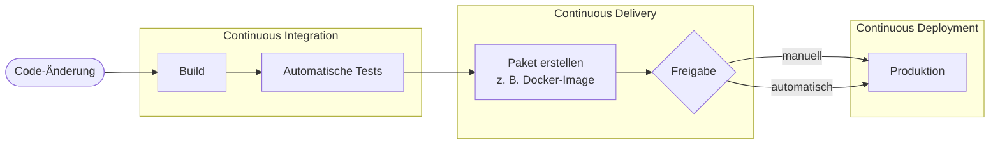
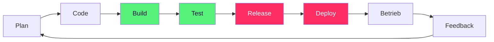
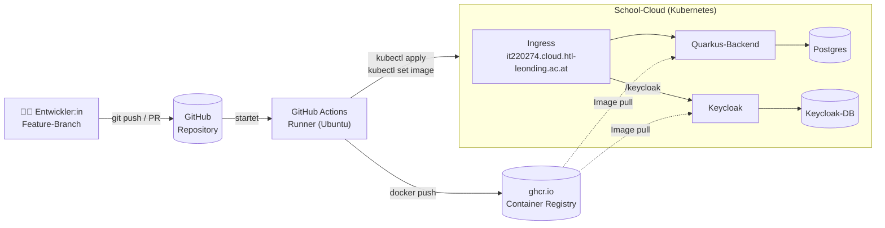
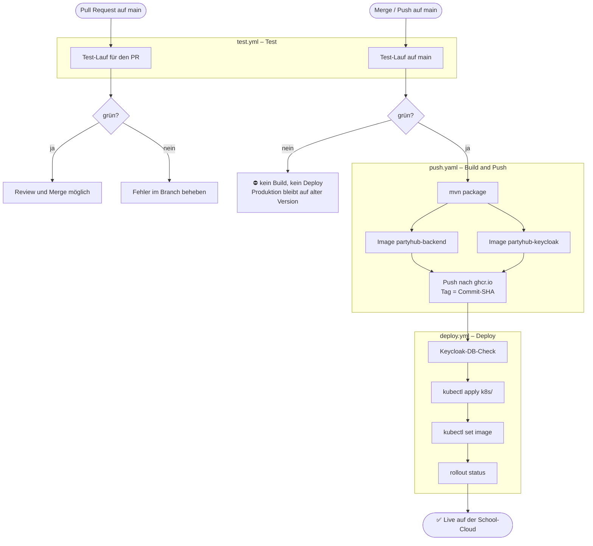
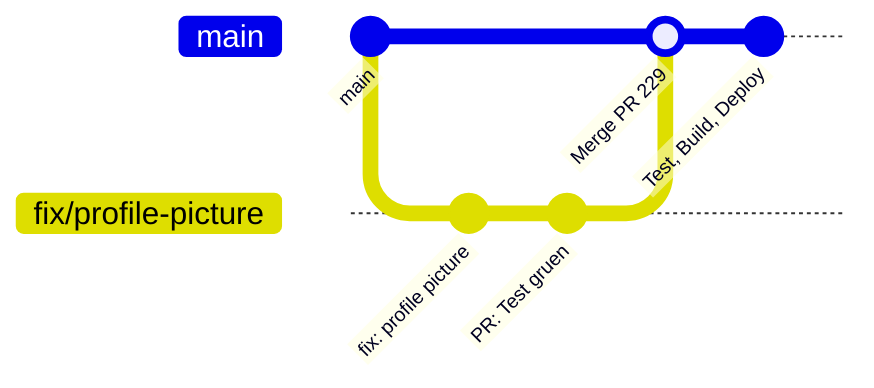
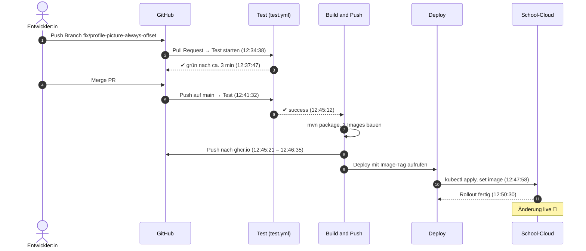
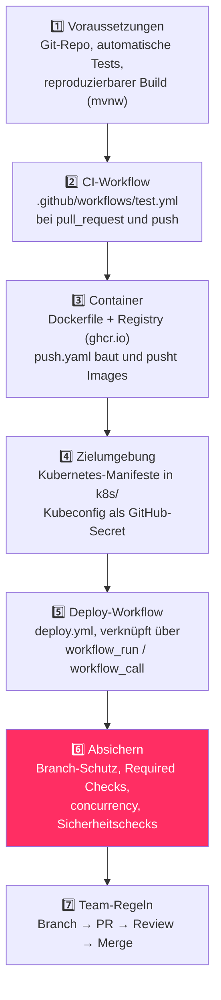
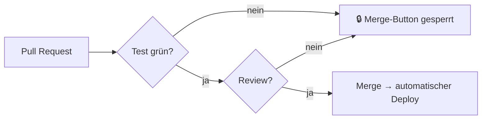

# CI/CD bei PartyHub

> Referat, ca. 15 Minuten. Die Diagramme sind in Mermaid geschrieben und werden auf GitHub und in IntelliJ direkt als Grafik angezeigt.

## Ablauf des Referats

| # | Teil | Dauer | Inhalt |
|---|---|---|---|
| 1 | Einstieg | 1 min | Problem: „Bei mir funktioniert's!“ |
| 2 | Was ist CI/CD? | 3 min | Begriffe CI, Continuous Delivery, Continuous Deployment |
| 3 | CI/CD bei PartyHub | 4 min | Unsere Pipeline: Test → Build and Push → Deploy |
| 4 | Beispiel aus unserem Projekt | 4 min | PR #229 (grün → live) und PR #228 (rot → Deploy blockiert) |
| 5 | So setzt man es um | 2 min | Schritte zur Umsetzung und was wir noch tun müssen |
| 6 | Fazit und Fragen | 1 min | Kernaussagen |

---

## 1. Einstieg: Warum überhaupt? (1 min)

Ohne Automatisierung läuft ein Release bei einem Team-Projekt ungefähr so:

1. Jemand merged Code auf `main`.
2. Jemand anderes baut das Projekt **lokal** auf dem eigenen Laptop.
3. Das Docker-Image wird per Hand hochgeladen.
4. Auf dem Server wird per Hand `kubectl` ausgeführt.
5. Erst dann merkt man, dass die Tests gar nicht liefen, ein Schritt vergessen wurde oder „bei mir hat's funktioniert“.

**CI/CD ersetzt diese Handarbeit durch eine automatische Pipeline.** Jede Änderung durchläuft dieselben Schritte in einer sauberen Umgebung, jedes Mal.

---

## 2. Was ist CI/CD? (3 min)



| Begriff | Bedeutung | Kurz gesagt |
|---|---|---|
| **CI – Continuous Integration** | Jede Codeänderung wird automatisch gebaut und getestet, sobald sie ins gemeinsame Repository kommt. | „Funktioniert mein Code noch zusammen mit dem der anderen?“ |
| **CD – Continuous Delivery** | Nach erfolgreichen Tests entsteht automatisch ein auslieferbares Paket. Das Ausrollen kann noch manuell angestoßen werden. | „Wir *könnten* jederzeit ausliefern.“ |
| **CD – Continuous Deployment** | Das fertige Paket wird ohne manuellen Schritt in Produktion ausgerollt. | „Jede erfolgreiche Änderung ist sofort live.“ |

Der Unterschied zwischen den beiden „CD“ liegt nur im letzten Schritt: **Delivery** wartet auf einen Klick, **Deployment** rollt automatisch aus.

### Der DevOps-Kreislauf

CI/CD ist der automatisierte Teil eines Kreislaufs, der sich bei jeder Änderung wiederholt:



Grün = CI, Pink = CD.

### Vorteile

- **Fehler früh finden:** Kaputter Code fällt im Pull Request auf, nicht erst auf dem Server.
- **Keine manuellen Handgriffe:** Niemand muss lokal bauen, Images hochladen oder `kubectl` per Hand aufrufen.
- **Nachvollziehbarkeit:** Jedes Image ist mit dem Commit getaggt, aus dem es gebaut wurde.
- **Kleine, häufige Releases** statt seltener großer Releases. Bei uns gehen oft mehrere Änderungen pro Tag live.

### Werkzeuge

Eine **Pipeline** ist die Abfolge der automatischen Schritte. Bekannte Werkzeuge dafür sind GitHub Actions, GitLab CI, Jenkins und Azure DevOps. **Wir verwenden GitHub Actions.** Die Pipeline ist als YAML-Dateien in `.github/workflows/` beschrieben und liegt damit direkt im Repository.

---

## 3. CI/CD bei PartyHub (4 min)

### Architektur



### Was die Pipeline abdeckt

| Teil des Projekts | Was die Pipeline damit macht |
|---|---|
| Quarkus-Backend (`src/`, `pom.xml`) | Tests mit `mvn clean test`, danach Build zum Docker-Image `partyhub-backend` |
| REST-API (`api/*.http`) | API-Tests mit HTTPYac gegen einen echten laufenden Quarkus-Server |
| Frontend-JavaScript (`src/test/js`, `scripts/tests`) | Browser-Regressionstests mit `node --test` |
| Keycloak und Login-Theme (`keycloak/`, `Dockerfile.keycloak`) | Eigenes Docker-Image `partyhub-keycloak` mit unserem Theme |
| Datenbank-Schema (Flyway-Migrationen) | Laufen beim Start von Quarkus automatisch, in den Tests und in Produktion |
| Kubernetes-Manifeste (`k8s/`) | Werden beim Deploy mit `kubectl apply` angewendet |
| Sicherheit | CodeQL scannt bei jedem Push auf `main` den Code |

### Ist das bei uns schon automatisiert?

**Ja, vollständig, inklusive Continuous Deployment.**

| Stufe | Automatisiert? | Workflow |
|---|---|---|
| Continuous Integration | ✅ bei jedem Pull Request und jedem Push auf `main` | `test.yml` („Test“) |
| Continuous Delivery | ✅ Images werden nach grünem Test gebaut und nach `ghcr.io` gepusht | `push.yaml` („Build and Push“) |
| Continuous Deployment | ✅ Images werden direkt danach auf die School-Cloud ausgerollt | `deploy.yml` („Deploy“) |
| Code-Scanning | ✅ CodeQL bei Push auf `main` | GitHub Default-Setup |

### Die drei Workflows



**`test.yml` – Test** (bei jedem PR und Push auf `main`)

1. Java 21 einrichten
2. Browser-Regressionstests: `node --test scripts/tests/*.test.cjs src/test/js/*.test.cjs`
3. Docker-Compose-Datei und Shell-Skripte prüfen, Postgres und Keycloak starten
4. Backend-Tests: `mvn clean test`
5. Quarkus starten und warten, bis `/q/openapi` antwortet
6. API-Tests: alle `api/*.http` mit HTTPYac
7. Testergebnisse als Artefakt hochladen (7 Tage aufbewahrt)

**`push.yaml` – Build and Push** (nur nach grünem Test eines Pushes auf `main`)

1. Genau den getesteten Commit auschecken
2. Image-Tag = 7-stelliger Commit-SHA, zusätzlich `latest`
3. `mvn -B package -DskipTests`. Die Tests liefen schon im vorigen Workflow.
4. Backend-Image aus `Dockerfile` und Keycloak-Image aus `Dockerfile.keycloak` bauen und nach `ghcr.io` pushen

Bei PR-Testläufen wird dieser Workflow als „skipped“ angezeigt. Das ist korrekt so.

**`deploy.yml` – Deploy** (direkt nach Build and Push)

1. `kubectl` mit der Kubeconfig aus dem Secret `KUBE_CONFIG_DATA` einrichten
2. **Sicherheitscheck:** Das Secret `keycloak-database-secret` muss `migration-complete=true` enthalten. Sonst bricht der Deploy ab, damit Keycloak nicht mit leerer Datenbank startet und Benutzerkonten verliert.
3. `kubectl apply` für alle Manifeste in `k8s/`
4. `kubectl set image` setzt Quarkus und Keycloak auf den neuen Tag
5. `kubectl rollout status` wartet, bis alles läuft

Der Deploy ist **inkrementell**: Datenbanken und hochgeladene Bilder (PersistentVolumeClaims) bleiben erhalten. Über `concurrency` laufen nie zwei Deploys gleichzeitig.

### Der Ablauf für uns im Team



1. Eigenen Branch anlegen, z. B. `carla/settings` oder `fix/...`
2. Lokal testen: `./mvnw clean test` und `./run-http-tests.sh`
3. Pushen und Pull Request auf `main` öffnen. Die CI läuft automatisch.
4. Bei Rot: im Branch korrigieren und erneut pushen
5. Bei Grün: Review im Team, dann Merge
6. Die Pipeline baut und deployt automatisch. Nach ca. 9 Minuten ist die Änderung live.

---

## 4. Beispiel aus unserem Projekt (4 min)

### Beispiel A: PR #229, vom Fix bis live in 16 Minuten

PR #229 *„fix: always place the profile picture a bit further right“* ändert drei Dateien: `profile.css`, `profile.html` und `profile.js`. Alle Zeiten stammen aus den echten GitHub-Actions-Läufen vom 25.11.2026.

```mermaid
gantt
    title PR #229 – Zeitleiste am 25.11.2026
    dateFormat HH:mm:ss
    axisFormat %H:%M
    section Pull Request
    Test (PR)            :done, 12:34:38, 12:37:47
    Merge                :milestone, m1, 12:41:28, 1s
    section main
    Test (main)          :done, 12:41:32, 12:45:12
    Build and Push       :done, 12:45:21, 12:46:35
    Deploy               :done, 12:47:58, 12:50:30
```





**Vom Merge bis live: ca. 9 Minuten.** Niemand musste dafür etwas per Hand bauen oder auf den Server zugreifen.

### Beispiel B: PR #228, die Pipeline schützt die Produktion

Ein Fehler hat dieses Beispiel interessant gemacht:

```mermaid
flowchart LR
    A["PR #228<br/>feat: settings page"] --> B["Test im PR ✘<br/>Keycloak-Container<br/>startet nicht (exit 1)"]
    B --> C["Trotzdem gemergt<br/>(main ist nicht geschützt)"]
    C --> D["Test auf main ✘"]
    D --> E["Build and Push: skipped<br/>Deploy: läuft nicht"]
    E --> F["✅ Produktion bleibt<br/>auf der alten,<br/>funktionierenden Version"]
    F --> G["PR #231 fix: dev Keycloak<br/>realm importiert wieder"]
    G --> H["Test ✔ → Build → Deploy 🚀"]

    style B fill:#ff2e63,color:#ffffff
    style D fill:#ff2e63,color:#ffffff
    style F fill:#56f27c,color:#1a1040
    style H fill:#56f27c,color:#1a1040
```



Was passiert ist:

1. Der Test-Workflow für PR #228 war **rot**. Im Schritt „Start databases and Keycloak“ ist der Keycloak-Container mit `exited (1)` abgestürzt, weil das lokale Dev-Realm nicht mehr importiert werden konnte.
2. Der PR wurde **trotzdem gemergt**. Das ging, weil `main` keinen Branch-Schutz hat.
3. Der Test auf `main` war ebenfalls rot. Deshalb liefen **weder Build noch Deploy**. Die Produktion blieb unverändert.
4. Mit PR #231 *„fix: let the dev Keycloak realm import with the demo users again“* war der Test wieder grün, und die Pipeline lief durch.

**Was man daraus lernt:**
- Die Pipeline hat verhindert, dass ungetesteter Code live geht. ✅
- Sie hat aber nicht verhindert, dass roter Code auf `main` landet. ❌ Dafür braucht es Branch-Schutz (siehe Teil 5).

### Live zeigen im Referat

- GitHub → Tab **Actions** → Workflow „Test“ öffnen und die einzelnen Schritte aufklappen
- Den Run von PR #229 mit den Jobs `build-and-push` → `deploy / deploy` zeigen
- GitHub → **Packages**: Images mit den Commit-SHA-Tags zeigen
- Im Terminal: `gh run list --limit 10`
- Die Website `https://it220274.cloud.htl-leonding.ac.at` öffnen

---

## 5. So setzt man CI/CD um (2 min)

### Schritte zur Umsetzung

So wurde unsere Pipeline aufgebaut. Dieselben Schritte gelten für jedes neue Projekt:



**1. Voraussetzungen schaffen**
- Der Code liegt in einem gemeinsamen Git-Repository.
- Es gibt automatische Tests: JUnit/Quarkus-Tests, HTTPYac-API-Tests, Node-Tests.
- Der Build läuft auf jedem Rechner mit einem Befehl, ohne lokale Sonderkonfiguration: `./mvnw package`.

**2. CI-Workflow anlegen.** Minimalbeispiel:

```yaml
# .github/workflows/test.yml
name: Test
on:
  pull_request:
    branches: [ "main" ]
  push:
    branches: [ "main" ]
jobs:
  test:
    runs-on: ubuntu-latest
    steps:
      - uses: actions/checkout@v4
      - uses: actions/setup-java@v4
        with: { distribution: temurin, java-version: '21', cache: maven }
      - run: mvn clean test
```

**3. Images bauen und in eine Registry pushen**
- Ein `Dockerfile` pro Dienst, bei uns Backend und Keycloak
- Login mit dem automatischen `GITHUB_TOKEN`. Der Workflow braucht dafür `permissions: packages: write`.
- Images mit Commit-SHA taggen, damit jede Version eindeutig ist

**4. Zielumgebung vorbereiten**
- Kubernetes-Manifeste (Deployment, Service, Ingress, PersistentVolumeClaims) ins Repo legen
- Die Kubeconfig der School-Cloud base64-kodiert als Secret anlegen: **Settings → Secrets and variables → Actions → New repository secret** `KUBE_CONFIG_DATA`
- Passwörter wie SMTP oder Keycloak-Admin als Kubernetes-Secrets anlegen, **nie** ins Repo

**5. Deploy-Workflow verknüpfen**
- `push.yaml` startet über `workflow_run` erst, wenn „Test“ erfolgreich war
- `deploy.yml` wird über `workflow_call` mit dem Image-Tag aufgerufen
- `workflow_dispatch` erlaubt einen manuellen Start, zum Beispiel für einen Rollback

**6. Absichern**
- Mit `concurrency` laufen nie zwei Deploys gleichzeitig
- Vor dem Deploy prüfen, ob die Voraussetzungen stimmen. Bei uns ist das der Keycloak-DB-Check.
- **Branch-Schutz für `main`**, siehe unten

**7. Team-Regeln vereinbaren**
- Nie direkt auf `main` pushen
- Commit-Nachrichten im Stil von Conventional Commits (`feat:`, `fix:`, `docs:` …)
- Rote Pull Requests nicht mergen

### Was wir noch tun müssen

| Priorität | Aufgabe | Warum | Wie |
|---|---|---|---|
| 🔴 **Muss** | **Branch-Schutz für `main`** | Beispiel B: Ein roter PR konnte gemergt werden. Ein direkter Push würde sofort deployen. | Siehe Anleitung unten |
| 🟠 Sollte | **Rollback dokumentieren und üben** | Es gibt keinen automatischen Rollback. | Deploy-Workflow manuell mit altem Image-Tag starten |
| 🟠 Sollte | **Datenbank-Backup** | `sync-import.sh` ohne `--local-only` löscht die Produktionsdaten, und es gibt kein Backup. | Regelmäßiger `pg_dump`, z. B. als Kubernetes-CronJob |
| 🟡 Kann | **Staging-Umgebung** | Zurzeit gibt es nur lokal und Produktion. | Zweiter Namespace, der von einem `develop`-Branch deployt wird |
| 🟡 Kann | **Benachrichtigung bei Fehlern** | Rote Läufe auf `main` fallen sonst erst spät auf. | GitHub-Benachrichtigungen oder ein Webhook in den Team-Chat |

### Anleitung: Branch-Schutz einrichten

Dafür braucht man Admin-Rechte im Repository. Vorher im Team absprechen, weil es alle betrifft.

**Über die Website:** GitHub → **Settings → Branches → Add branch ruleset** für `main`:

- ✅ **Require a pull request before merging**, optional mit mindestens einem Approval
- ✅ **Require status checks to pass**, mit dem Check `test` aus `test.yml`
- ✅ **Block force pushes**
- ✅ **Restrict deletions**

**Über das Terminal:**

```bash
gh api -X PUT repos/htl-leo-itp-25-27-4-5BHITM/PartyHub/branches/main/protection \
  -F required_status_checks[strict]=true \
  -F 'required_status_checks[contexts][]=test' \
  -F enforce_admins=false \
  -F required_pull_request_reviews[required_approving_review_count]=1 \
  -F restrictions=null
```

Danach gilt:



Hinweis: Der Test-Workflow läuft bei Pull Requests immer, auch bei reinen Doku-Änderungen. Der Required Check blockiert deshalb keine Doku-PRs.

---

## 6. Fazit (1 min)

- **CI** = jede Änderung wird automatisch gebaut und getestet.
- **CD** = das Ergebnis wird automatisch verpackt (Delivery) und ausgerollt (Deployment).
- **PartyHub hat beides vollständig automatisiert:** `test.yml` → `push.yaml` → `deploy.yml`. Vom Merge bis live dauert es ca. 9 Minuten.
- **Die Pipeline schützt die Produktion:** Roter Code wird nicht deployt (Beispiel B).
- **Der nächste Schritt ist Branch-Schutz,** damit roter Code gar nicht erst auf `main` landet.

---

## Anhang

### Wichtige Regeln für das Team

- **Push auf `main` = Deployment in Produktion.** Immer über Branch und Pull Request arbeiten.
- Bestehende Flyway-Migrationen nie ändern. Sie sind in Produktion bereits angewendet.
- `./sync-import.sh` nur mit `--local-only` ausführen. Die anderen Varianten setzen die Produktionsdatenbank zurück.
- Ein grüner CI-Lauf ersetzt keinen echten Login-Test mit Keycloak. Die HTTPYac-Tests laufen mit `partyhub.auth.bypass-enabled=true`.
- Ändert ein Commit auf `main` nur Doku (`docs/`, `openspec/` …), laufen weder Test noch Build noch Deploy. Das ist gewollt.

### Dateien im Überblick

| Datei | Zweck |
|---|---|
| `.github/workflows/test.yml` | CI: Tests bei PR und Push auf `main` |
| `.github/workflows/push.yaml` | CD: Docker-Images bauen und nach `ghcr.io` pushen, danach Deploy aufrufen |
| `.github/workflows/deploy.yml` | CD: Rollout auf die School-Cloud |
| `Dockerfile` | Backend-Image (Java 21 JRE, Quarkus-App) |
| `Dockerfile.keycloak` | Keycloak-Image mit PartyHub-Theme |
| `k8s/*.yaml` | Kubernetes-Manifeste für Produktion |
| `docker-compose.yaml` | Lokale Umgebung und Test-Infrastruktur in der CI |

### Nützliche Befehle

```bash
gh run list --limit 10                        # letzte Pipeline-Läufe
gh run view <run-id> --log-failed             # Log eines fehlgeschlagenen Laufs
gh workflow run Deploy -f image-tag=<sha>     # manueller Deploy / Rollback
```
